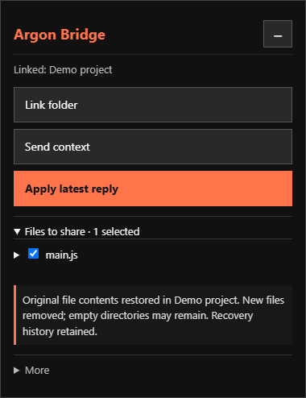

# Argon Bridge

A Chrome extension that connects Google AI Studio to a local project folder.

Open the bridge from Chrome's toolbar, put selected project files into your chat draft, and save complete files from the latest model reply after reviewing the changes. No console pasting, API key, or local server is needed.



## Install locally

1. Download and extract the ZIP, or download this repository.
2. In Chrome, open `chrome://extensions`.
3. Turn on **Developer mode**.
4. Click **Load unpacked** and select the folder containing `manifest.json`.
5. Open Chrome's extensions menu and pin **Argon Bridge**.
6. Open [Google AI Studio](https://aistudio.google.com/) and click the Argon Bridge toolbar icon.

The extension is installed locally through Developer mode. This package is not a Chrome Web Store listing. Keep the extracted folder in place while the extension is installed.

If you used an older console-script version, export any backups and use **Exit bridge** in that version before opening the extension.

## Use the three main buttons

### Link folder

Choose your project in the browser's folder picker. Under **Files to share**, select the files you want to include. Files start unchecked, and your selections are remembered while the bridge stays open.

### Send context

Refresh the selected files and add their contents to your existing AI Studio draft. Add your task and press **Run** in AI Studio yourself. The extension does not send the message for you.

The bridge minimises to a floating **Ar** icon. Click the icon to restore it. Both the panel and icon can be dragged around the page.

### Apply latest reply

Wait for the model to finish, then click **Apply latest reply**. The bridge fetches code from the newest model reply automatically; you do not need to copy, select, or paste the reply.

Review the proposed files, then click **Save N files** to write them to your linked folder. Changes to files edited since sharing or previewing are blocked.

**More** contains Undo, Download backups, chat-box selection, clipboard copy, refresh, manual-response fallback, and Exit.

## How the model should return files

Use **Send context** first: it includes instructions for returning complete files with paths.

Each code block should start with a filename header:

```javascript
FILE: src/main.js
console.log('Hello from Argon Bridge');
```

The header is removed before saving. Plain `FILE:` headers and comment forms such as `// FILE: src/main.js`, `# FILE: script.py`, and `<!-- FILE: index.html -->` are accepted. Paths may contain spaces and hyphens.

A JSON manifest is also supported:

```json
{
  "version": 1,
  "files": [
    {
      "path": "src/main.js",
      "content": "console.log('Hello from Argon Bridge');\n"
    }
  ]
}
```

If one code block has no filename, the bridge can infer its destination only when there is one compatible project file. Ambiguous destinations are refused. Return complete files rather than patches, partial snippets, or placeholders.

## Undo and recovery

- Original contents are retained before a write begins.
- **Undo last batch** checks for newer edits before restoring files.
- Each batch stays tied to its original folder, including after switching projects.
- Failed writes attempt rollback. If recovery is incomplete, the bridge reports the affected files and retains the original snapshots.
- **Download backups** exports the recovery history as JSON. Verify that the download saved successfully.

Folder handles, selections, previews, and recovery history live in the page session. **Export backups before refreshing, navigating away, closing the tab, reloading the extension, or exiting the bridge.** These actions reset the in-memory session.

Writes are sequential rather than one atomic filesystem transaction. Browser folder APIs cannot lock files against an external editor changing them between a check and a write. Use version control for projects you care about.

## Permissions and privacy

| Permission | Purpose |
| --- | --- |
| `activeTab` | Access the current tab after you click the toolbar icon. |
| `scripting` | Run the bundled bridge on the supported AI Studio page. |
| `clipboardWrite` | Provide the optional **Copy context** fallback. |

The extension does not automatically run on every website, and it makes no direct network requests. It has no backend, analytics, or API-key requirement. Local file access is granted separately through the browser's folder picker.

Selected code is inserted into AI Studio's editor. AI Studio may save drafts, and running the prompt sends that content to Google. Check your selections before adding context. Common sensitive filenames are excluded and possible secrets are flagged, but detection is a heuristic, not a guarantee. `.gitignore` rules are not interpreted.

Recovery downloads can contain private source code. Keep those files out of public repositories.

## Compatibility and limits

- Intended for Google AI Studio in desktop Chrome. A Chromium browser must support the File System Access API; Firefox and Safari are not supported by this package.
- AI Studio's page structure can change. If automatic fetching stops working, use the manual fallback under **More** and report the page behavior.
- Context filling supports textareas and compatible rich text editors. Use **More → Choose chat box** if several editors are found, or **Copy context** if the site rejects generated input.
- Only UTF-8 text files are supported. Binary content is refused.
- Up to 200 KB per file, 2 MB per response/context, and 100 file updates per batch.
- Scanning stops at 10,000 entries or 20 directory levels.
- Recovery history retains up to 20 batches or 20 MB of original/proposed contents. At the limit, export backups and start a new session.
- No background auto-save, file-deletion operation, or automatic execution of generated code is provided.

## Development

The extension uses plain JavaScript and Manifest V3. No build step is required.

```text
manifest.json       Extension configuration and permissions
service-worker.js   Toolbar action and script injection
bridge.js           Floating interface and project bridge
icons/              Extension icons
tests/              Regression checks using simulated files
```

Run the packaged tests with Node.js and npm:

```sh
npm test
```

Node.js 20 or newer is needed only for development tests; installation and normal use need no Node.js or package installation. The included tests run 18 bridge regression checks and five extension-package checks against simulated APIs and files.

The unpacked extension was also loaded into a separate Chromium-based browser profile and exercised through its real toolbar action. That check verified the isolated folder-picker API, context filling, latest-reply import, simulated file writes, undo and toolbar restore. Native folder-picker dialogs and real project writes still need a manual trial in your Chrome installation.

After editing extension files, click **Reload** on `chrome://extensions`, then refresh the AI Studio tab and reopen the bridge. Export session backups before doing this.

When reporting a bug, include the browser version, the button used, and the bridge's status message. Use a small example that does not contain private code or credentials.

## Project notes

Argon Bridge began as a browser-console bridge prototype and was refactored into this extension with explicit file review, conflict checks, recovery history, and a compact interface.

No license has been selected for this package.
